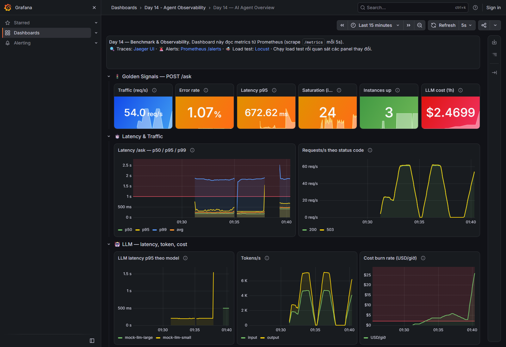
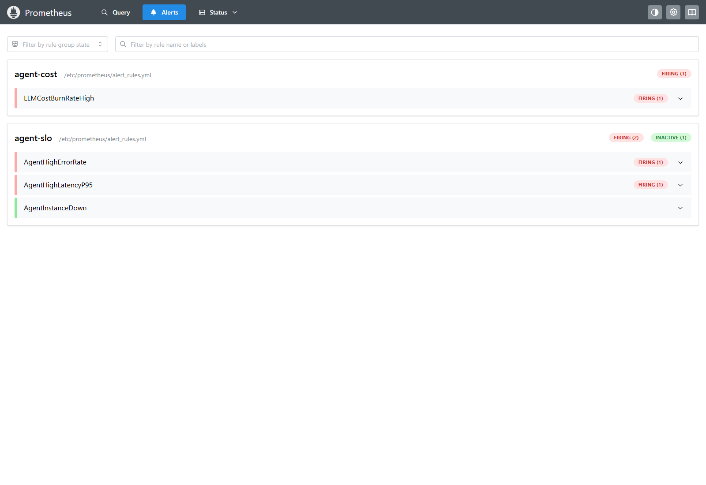

# Benchmark & Observability Report — Day 14

**Họ tên:** Trần Thanh Nam

Develop đo ngày 2026-11-25 trên Windows/Python 3.12.10, localhost:8014.
Production đo ngày 2026-11-26 bằng Docker Desktop Linux containers, mỗi agent giới hạn 0,5 CPU/256 MB. Các lượt đo dùng chung máy với tác vụ build Docker, nên có thể chịu tranh chấp tài nguyên; đây không phải benchmark trên máy cô lập.

## 1. SLO

Develop: p95 ≤ 500 ms, error rate ≤ 2%, accuracy 100%. Production alert mặc định: error rate > 5% trong 1 phút; p95 > 1 giây trong 2 phút.
Mỗi lượt develop có 200 request, mock-llm-small, MOCK_ERROR_RATE=0; các biến khác mặc định trừ slow rate được ghi riêng. Số đo của mock không đại diện năng lực LLM/cloud thật.

## 2. Hiệu năng develop

| Concurrency | RPS | p50 ms | p95 ms | p99 ms | Error rate | SLO |
|---|---|---|---|---|---|---|
| 1 | 4.38 | 201.5 | 232.8 | 1692.1 | 0.0% | True |
| 10 | 35.47 | 187.8 | 467.2 | 1722.5 | 0.0% | True |
| 50 | 80.18 | 214.6 | 543.3 | 2001.8 | 0.0% | False |
| 100 | 55.45 | 647.2 | 1640.4 | 2054.3 | 0.0% | False |

RPS không tăng tuyến tính do overhead client/server, thời gian chờ mock và tail latency. 200 mẫu chỉ mô tả lượt đo này, cần lặp nhiều lượt để kết luận ổn định.

### Tail latency

| Slow rate | avg ms | p95 ms | p99 ms |
|---|---|---|---|
| 0 | 203.3 | 235.4 | 470.2 |
| 0.03 | 233.8 | 455.0 | 1701.2 |
| 0.1 | 327.1 | 1692.6 | 1730.7 |

Percentile cao nhạy với request chậm. Average có thể thấp dù một nhóm người dùng phải đợi lâu.

## 3. Chất lượng

| Phiên bản | Accuracy | Avg tokens | Cost USD | Cost/câu đúng USD | Gate |
|---|---|---|---|---|---|
| v1 | 1/23 | 57.0 | 0.000402 | 0.00040215 | False |
| v2 | 21/23 | 109.1 | 0.000762 | 3.627e-05 | False |
| v2_fixed | 23/23 | 112.9 | 0.000784 | 3.407e-05 | True |

Bổ sung knowledge base cho security-02: JWT có token, chữ ký, hết hạn; scaling-03: HPA dựa CPU, memory, custom metrics. Thêm user_id vào nhóm cardinality để ưu tiên đúng tài liệu. Giữ nguyên golden dataset. Gate dùng pass-threshold mặc định 0.6; kết quả fixed có avg_score=1.0 và không regression. Retrieval làm tăng token và latency nhưng cải thiện thông tin câu trả lời.

CI chạy `python eval/run_eval.py --min-accuracy 1.0 --baseline reports/eval_v2.json` sau khi khởi động agent. Exit code khác 0 làm job fail; đặt job thành required check để chặn merge.

## 4. Observability

Metrics mô tả traffic, latency, errors và saturation. Logs ghi sự kiện; traces phân rã request thành span. Route template tránh cardinality cao. user_id làm bùng nổ time series và RAM. Sampling giảm chi phí nhưng dễ bỏ sót lỗi hiếm; nên ưu tiên lưu trace lỗi/chậm. `for: 0s` dễ nhiễu; `for: 30m` phát hiện quá chậm. Prometheus pull cần target tồn tại; scale-to-zero cần cân nhắc đường thu telemetry phù hợp.

Đổi v2 sang v1 có thể vẫn trả HTTP 200: alert hạ tầng không phát hiện câu trả lời sai, cần eval định kỳ và canary chất lượng. Lỗi 504 tại Nginx có thể không xuất hiện trong metric agent; cần metric gateway và synthetic checks.

Thí nghiệm kết hợp MOCK_ERROR_RATE=0.2 và MOCK_SLOW_RATE=0.3; thời gian tính từ lúc bắt đầu recreate agent, polling mỗi 10 giây.

| Alert | Lần đầu quan sát firing (s) |
|---|---|
| LLMCostBurnRateHigh | 1.7 |
| AgentHighErrorRate | 81.8 |
| AgentHighLatencyP95 | 141.9 |

Bằng chứng: `reports/alerts-timeline.json`. Hai lỗi được bật đồng thời để quan sát hai alert; đây không phải phép đo tác động độc lập của từng lỗi. LLMCostBurnRateHigh nếu xuất hiện ngay đầu lượt có thể là trạng thái còn lại từ thí nghiệm model lớn, không phải thời gian phát hiện mới.

### Các thí nghiệm bổ sung

- Model lớn, 100 users trong 150 giây: alert firing quan sát cuối lượt: LLMCostBurnRateHigh. Dữ liệu cost trước/sau trong `reports/extra-experiments.json`, log tải trong `reports/large-load.log`.
- Pause một instance: lần đầu quan sát AgentInstanceDown firing sau 40.2 giây; polling 5 giây. Sau đo đã unpause.
- Chuyển production về v1: accuracy 1/23, exit code 1. Quality gate phát hiện regression dù endpoint vẫn hoạt động. Alert hạ tầng còn tồn dư cửa sổ trước đó không phải bằng chứng phát hiện chất lượng. Đã khôi phục v2.

## 5. Scaling — Locust 100 users, spawn rate 10/s, 2 phút mỗi lượt

Hai lượt chạy tuần tự trên cùng host, cùng cấu hình, dùng CSV `scale_clean_*` để không trộn số từ lượt cũ.

| Instance | Requests | RPS | p50 ms | p95 ms | p99 ms | Failures |
|---:|---:|---:|---:|---:|---:|---:|
| 1 | 7741 | 65.36 | 190 | 260 | 1700 | 64 |
| 3 | 7808 | 65.32 | 190 | 230 | 1700 | 65 |

Từ 1 lên 3 instance, throughput gần như không đổi trên máy đo này; p95 của lượt 3 instance thấp hơn 30 ms. p99 vẫn bị ảnh hưởng bởi mock chậm. Tỷ lệ lỗi khoảng 0,8% ở cả hai lượt, phù hợp với `MOCK_ERROR_RATE` mặc định xấp xỉ 1%; failures không phải lỗi Locust. Máy chạy đồng thời các container quan sát nên kết quả chỉ đại diện cho lần đo này. CSV và lịch sử gốc nằm trong `benchmark-results/`; tóm tắt máy đọc được trong `reports/scaling-clean-evidence.json`.

## 6. Kết luận

Latency trung bình không mô tả đuôi chậm; HTTP 200 không chứng minh chất lượng; mọi kết luận cần đi cùng dữ liệu gốc và điều kiện đo. Production thật cần thêm alert chất lượng, chi phí, Redis và gateway.

## 7. Trace và triển khai public

| Bằng chứng | Kết quả |
|---|---|
| Trace chậm | `5d96f1992f1b063bce186b47d1cfc413`; `chat mock-llm-small` 1.686 ms; log đối chiếu trong `reports/trace-correlated-log.txt` |
| Trace lỗi | `eda096a946340e2fac333b72646ff796`; mock upstream 503, request `/ask` trả 503 |
| Public `/health` | HTTP 200, `status=ok` |
| Public `/ready` | HTTP 200, `status=ready` sau khi cấu hình Redis |
| Public `/ask` không có key | HTTP 401 như mong đợi |
| Public `/ask` có key và rate limit | HTTP 200 cho request hợp lệ; HTTP 429 sau các request lặp lại (đã xác nhận bằng script kiểm tra) |

Ảnh Jaeger: [trace chậm](screenshots/jaeger-slow-trace.png), [trace lỗi](screenshots/jaeger-error-trace.png). Ảnh deployment Render: [dashboard](screenshots/render-dashboard.jpg); ảnh endpoint: [health](screenshots/running.png), [readiness](screenshots/ready.png), [401](screenshots/test-auth.png). Kết quả kiểm tra public được ghi trong `reports/public-api-checks.json`. Script chỉ lưu status code; không ghi secret hay body phản hồi vào báo cáo.
